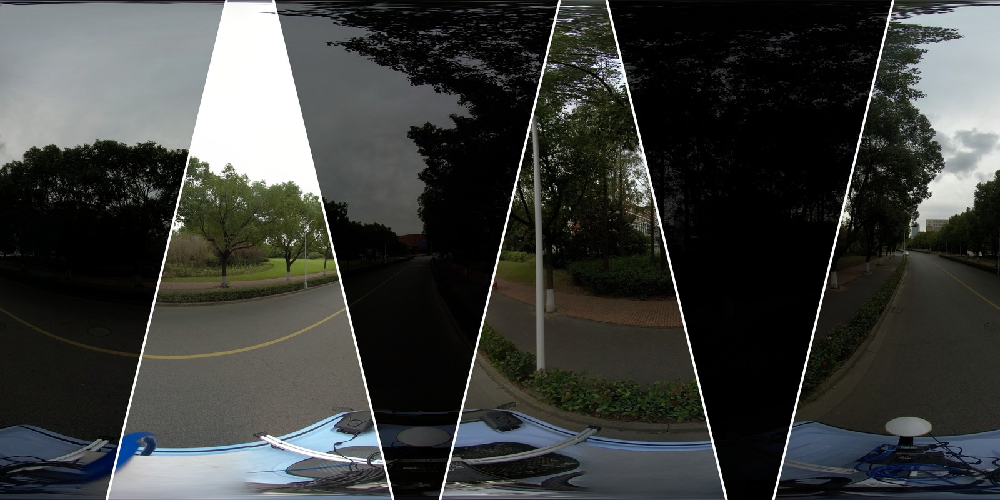
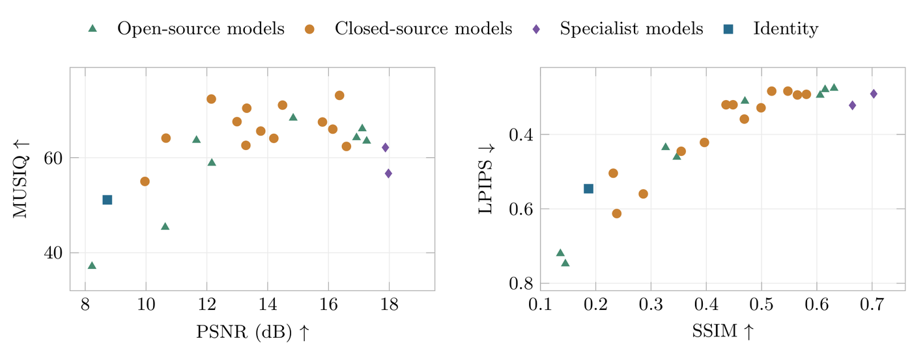

# OmniLowLight

**Benchmarking Generative Low-Light Enhancement Across Image Representations**  
Accepted to IEEE Open Journal on Immersive Displays (OJID).

Yushuo Zheng, Hao Jiang, Lei Fan, Kaiyuan Ji, Haijiang Sun, Yide Liu, Huiyu Duan, and Zicheng Zhang.

[Project website](https://Frank-Y-Zheng.github.io/OmniLowLight/) · [Request dataset access](https://docs.google.com/forms/d/e/1FAIpQLSeag4SsvnbCV0tmiLBIKlMib-FyDJ1MGoPMuy3a0LfK-vCrrA/viewform) · [Dataset access terms](DATASET_TERMS.md)



## Overview

OmniLowLight evaluates low-light enhancement across panoramic, perspective, and fisheye images. The benchmark uses **captured daytime underexposure**, with paired, well-exposed photographic references. It does not evaluate nighttime photography.

| Benchmark | Scope |
| --- | --- |
| Paired inputs and references | 150 pairs, 50 per representation |
| Source captures represented | 105 |
| Geographic blocks | 51 |
| Evaluated configurations | 21 generative-editor configurations, 2 specialist methods, and Identity |
| Evaluated outputs | 3,600 |
| Quality metrics | PSNR, SSIM, LPIPS, and MUSIQ |

All methods are evaluated on a fixed reference grid with full-frame scoring. Reported uncertainty uses geographic-block bootstrap intervals.

## Dataset access

**Access is restricted to approved, non-commercial academic research. Redistribution is not permitted.**

1. Read the [dataset access terms](DATASET_TERMS.md).
2. Complete the [Google access-request form](https://docs.google.com/forms/d/e/1FAIpQLSeag4SsvnbCV0tmiLBIKlMib-FyDJ1MGoPMuy3a0LfK-vCrrA/viewform) using your own institutional email address.
3. The maintainers review your affiliation, intended use, and agreement to the terms.
4. Approved applicants receive access instructions privately.

Submitting the form does not automatically grant access. Dataset files, model-output archives, and download credentials are not hosted in this repository. Do not publish or forward access links. Other researchers must submit their own requests.

The requested benchmark materials cover 150 input/reference pairs and the archived outputs underlying the paper, subject to approval. The full 618-capture source collection and satellite imagery are outside this benchmark access package.

## Evaluation



Reference-based leaders vary across image representations. Retinexformer has the highest macro PSNR, HVI-CIDNet the highest macro SSIM, and Step-1x the lowest macro LPIPS. GPT Image 2 has the highest predicted-quality MUSIQ score. These measures describe different aspects of enhancement quality and should be considered together.

## Citation

Please cite the paper when using OmniLowLight. Volume, pages, and DOI will be added after publication metadata is assigned.

```bibtex
@article{zheng2026omnilowlight,
  title   = {OmniLowLight: Benchmarking Generative Low-Light Enhancement Across Image Representations},
  author  = {Zheng, Yushuo and Jiang, Hao and Fan, Lei and Ji, Kaiyuan and Sun, Haijiang and Liu, Yide and Duan, Huiyu and Zhang, Zicheng},
  journal = {IEEE Open Journal on Immersive Displays},
  note    = {Accepted for publication}
}
```

The project figures are paper previews. Their availability does not grant permission to redistribute the underlying dataset. Dataset access follows the terms linked above; no open-data license is granted by this repository.
